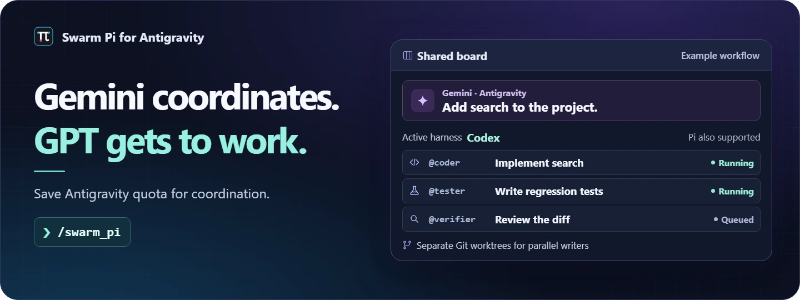

# agy-swarm-pi (`swarm-pi`)

English · [简体中文](README.zh-CN.md)



[](LICENSE)

Run `/swarm_pi` in **Google Antigravity** to split a task among named workers. With **Codex** selected, Gemini plans and assigns the work, and GPT implements features, writes tests, and reviews changes through the Codex CLI. Choose **Pi** to run those workers with your configured model provider.

**Save Antigravity quota for coordination.** Worker execution uses the selected CLI's own credentials and provider quota. Gemini still uses Antigravity for planning, dispatch, and follow-up. Track progress, handoffs, and results on a shared board, and give parallel writers separate Git worktrees.

## Features

- **Background coordination**. Dispatch through MCP, follow the workers from the Pi Swarm panel, and let board events wake the original conversation when it has work to do.
- **Named workers and shared messages**. Workers can hand off tasks with `@mentions`. Each worker keeps its session and working directory for follow-ups. Select a worker's Subagent card in the Pi Swarm panel to inspect its brief, latest task status and elapsed time, tool calls, model, worktree, and log path when available.
- **Git worktree isolation**. Give parallel writers separate worktrees and `swarm-pi/*` branches. Review the changes and clean up the worktrees when finished.
- **Per-role settings**. Configure model, reasoning, and timeout for roles such as coder, verifier, and researcher. Pi exposes a tool allowlist. Codex exposes a sandbox setting.
- **Prebuilt plugin**. The repository and release archives include the MCP server, panel, and coordinator sidecar. Antigravity starts the server directly with Node.js.

## Prerequisites

Use Node.js 20 or newer on the `PATH` inherited by Antigravity. Install and authenticate the CLI you plan to use.

```bash
npm install -g @mariozechner/pi-coding-agent
```

For Codex, install the CLI and sign in. The plugin reuses the CLI's authentication and loads its configured model when the model field is blank.

```bash
npm install -g @openai/codex
codex login
```

## Install

### Ask Antigravity to install it

Paste this into an Antigravity conversation.

```text
Install the Swarm Pi plugin from https://github.com/KLOSYX/agy-swarm-pi.
Follow the repository's installation instructions for my operating system.
After installation, verify that Swarm Pi is enabled and tell me how to open its panel.
```

### From a GitHub release

Download the version you want from [GitHub Releases](https://github.com/KLOSYX/agy-swarm-pi/releases). This example installs v0.5.0.

```bash
curl -fsSLO https://github.com/KLOSYX/agy-swarm-pi/releases/download/v0.5.0/swarm-pi-v0.5.0.tar.gz
tar -xzf swarm-pi-v0.5.0.tar.gz
./swarm-pi/install.sh
```

To install only in one project, use `--workspace`. This installs the plugin under `<repo>/.agents/plugins/swarm-pi`.

```bash
./swarm-pi/install.sh --workspace /path/to/your/repo
```

### From a clone

```bash
git clone https://github.com/KLOSYX/agy-swarm-pi.git
./agy-swarm-pi/install.sh
```

You can also install the cloned plugin with the Antigravity CLI.

```bash
agy plugin install ./agy-swarm-pi
```

On Windows, run the Antigravity CLI command in PowerShell. If Windows reports that the installed plugin is in use during an upgrade, quit Antigravity and retry. Version 0.4.0 and later start the MCP server with `node` directly. If the side panel is missing after upgrading, refresh `swarm-pi_pi` or restart Antigravity and check that `node --version` works in a terminal launched from the same environment.

To remove a global installation, run the installed script with `--uninstall`.

```bash
~/.gemini/config/plugins/swarm-pi/install.sh --uninstall
```

## Use Pi Swarm

1. If Antigravity was open during installation, refresh the `swarm-pi_pi` MCP server or restart Antigravity.
2. Open **Pi Swarm** from the sidebar or the conversation's **+** menu. In **Model and role settings**, choose **Pi** or **Codex** under **Active harness**, set the executable path if needed, and save. Pi is the initial choice. Codex uses `read-only` by default and `workspace-write` for the built-in coder role.
3. Run `/swarm_pi <your task>` in the main conversation. The coordinator creates the board, names the workers, and assigns tasks.
4. Open **Shared message board** to follow the conversation. To send a follow-up, select a worker, enter your instructions, and send them. An idle worker resumes its session immediately. A busy worker processes queued messages in order.

Workers hand off work by including `SWARM_POST @worker message` in their final reply. The MCP server routes the message after the turn finishes. Repeated handoffs and chains that reach the safety limit are paused with the pending message available to the coordinator. Finish or cancel active tasks before switching harnesses. Existing boards stay readable and become available for posting again when their original harness is selected.

The plugin data directory stores board history, coordinator cursors, assignment keys, task logs, Pi sessions, and Codex session IDs. Restarting the MCP server restores boards and marks unconfirmed assignments as interrupted so they can be reviewed before any follow-up. Codex stores its session transcripts in its own CLI data directory. Codex's JSONL output does not report the actual model, so the panel shows the configured model separately.

### Update from the panel

In **Settings → Plugin updates**, select **Check for updates** to compare the running plugin with the latest stable GitHub release. For an eligible release installation, select **Install update** and confirm. The updater verifies the archive against its SHA-256 file and keeps a backup of the previous plugin directory. Running and queued work blocks installation.

Reload the plugin in Antigravity when you are ready to switch versions. Reloading restores boards saved by versions with board persistence. Boards created before persistence were held in the old process. Settings and session data stored outside the plugin directory are kept. For a Git checkout, use Git to update it. For a linked plugin directory, update the source directory.

If the panel reports that data is inside the plugin directory, finish all tasks and exit Antigravity. Copy the data directory (usually `.data`) to a location outside the plugin directory and verify the backup. Run the installer with the original installation target, then copy the data back to its original path before opening Antigravity. The manual installer replaces the target directory.

### Event-driven follow-up

The coordinator dispatches through `swarm-pi_pi` and ends its turn. The board subscribes the owning conversation at creation. Enable the bundled coordinator sidecar in Antigravity's `~/.gemini/config/config.json` and reload Antigravity to receive follow-ups.

```json
{"sidecars": {"swarm-pi/coordinator": {"enabled": true}}}
```

A message addressed to the coordinator, a worker error, or completion of queued work wakes the original conversation. The coordinator reads its actionable inbox, acknowledges processed pages, and can look up any full post by message number. A retried assignment with the same key and arguments returns the original receipt. Updates are always available in the Pi Swarm panel, including when automatic wake is unavailable. [Antigravity Sidecars](https://antigravity.google/docs/sidecars/#agentapi)

## Develop and package

```bash
npm install
npm run build
npm test
npm run pack
```

`npm run pack` builds the bundles and writes ZIP and tar.gz archives with SHA-256 checksum files to `dist/`. Pushing a `vX.Y.Z` tag that matches the plugin version triggers GitHub Actions to build, test, verify, and publish the archives and checksums.
